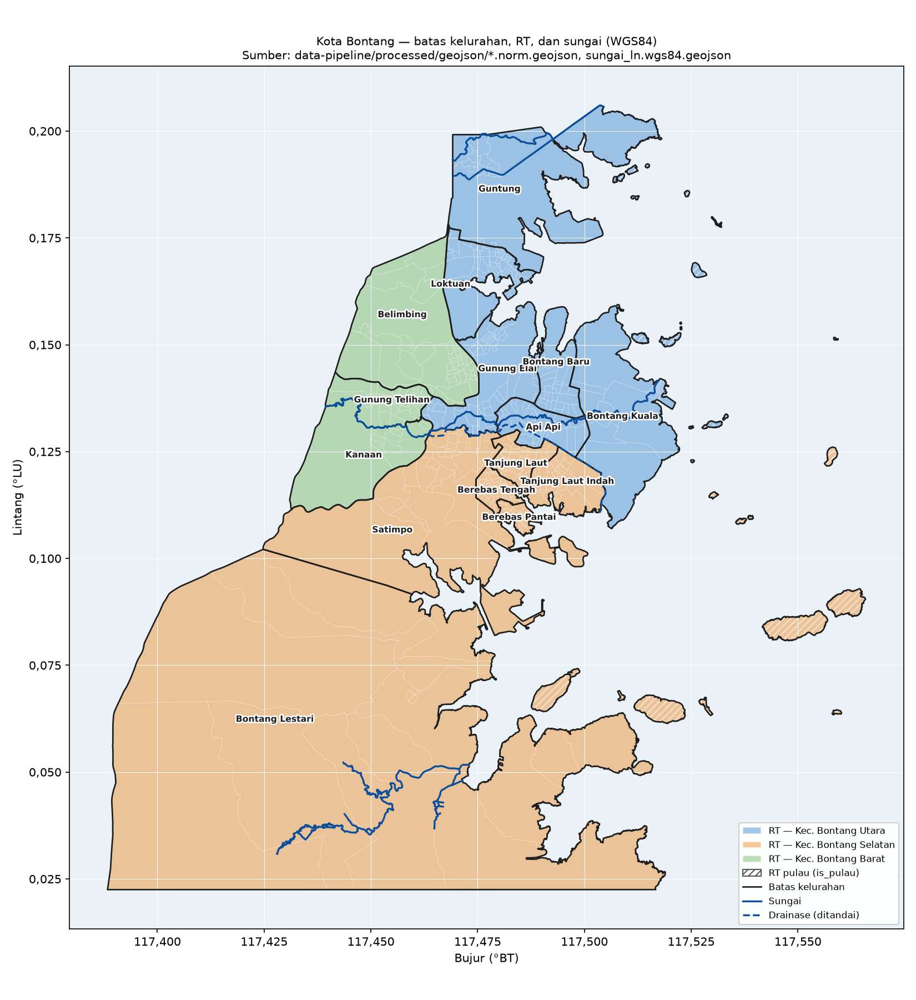

# Ringkasan data GeoJSON — Kota Bontang

Dibuat oleh `data-pipeline/scripts/show_data.py`. Angka dalam format Indonesia.

## Tabel 1 — 15 kelurahan (luas: luaswh vs geometri planar UTM 50N)

| Nama asli          | Nama normal        | Slug               | Jumlah RT   | Luas luaswh (ha)   | Luas geometri (ha)   | Selisih (%)   | Status cocok       |
|--------------------|--------------------|--------------------|-------------|--------------------|----------------------|---------------|--------------------|
| Api-Api            | Api Api            | api_api            | 42          | 216,09             | 216,09               | 0,000         | pemetaan_eksplisit |
| Belimbing          | Belimbing          | belimbing          | 51          | 958,49             | 958,49               | 0,000         | cocok_langsung     |
| Berbas Pantai      | Berebas Pantai     | berebas_pantai     | 24          | 56,24              | 56,24                | 0,000         | pemetaan_eksplisit |
| Berebas Tengah     | Berebas Tengah     | berebas_tengah     | 62          | 86,21              | 86,21                | 0,000         | cocok_langsung     |
| Bontang Baru       | Bontang Baru       | bontang_baru       | 28          | 221,57             | 221,57               | 0,000         | cocok_langsung     |
| Bontang Kuala      | Bontang Kuala      | bontang_kuala      | 30          | 894,67             | 894,67               | 0,000         | cocok_langsung     |
| Bontang Lestari    | Bontang Lestari    | bontang_lestari    | 23          | 8.782,41           | 8.782,41             | 0,000         | cocok_langsung     |
| Guntung            | Guntung            | guntung            | 24          | 1.109,87           | 1.134,93             | -2,208        | cocok_langsung     |
| Gunung Elai        | Gunung Elai        | gunung_elai        | 45          | 501,50             | 501,50               | 0,000         | cocok_langsung     |
| Gunung Telihan     | Gunung Telihan     | gunung_telihan     | 30          | 228,89             | 228,89               | 0,000         | cocok_langsung     |
| Kanaan             | Kanaan             | kanaan             | 12          | 603,31             | 603,31               | 0,000         | cocok_langsung     |
| Loktuan            | Loktuan            | loktuan            | 54          | 335,91             | 335,91               | 0,000         | cocok_langsung     |
| Satimpo            | Satimpo            | satimpo            | 27          | 1.772,55           | 1.772,55             | 0,000         | cocok_langsung     |
| Tanjung Laut       | Tanjung Laut       | tanjung_laut       | 38          | 142,85             | 142,85               | 0,000         | cocok_langsung     |
| Tanjung Laut Indah | Tanjung Laut Indah | tanjung_laut_indah | 36          | 252,11             | 252,11               | 0,000         | cocok_langsung     |

## Tabel 2 — RT per kecamatan (bermasalah = invalid / tumpang tindih > 0,1 m² / duplikat / keluar induk)

| Kecamatan       | RT   | RT pulau   | Invalid   | Tumpang tindih   | Duplikat   | Keluar induk   | RT bermasalah (unik)   |
|-----------------|------|------------|-----------|------------------|------------|----------------|------------------------|
| Bontang Barat   | 93   | 0          | 2         | 13               | 0          | 0              | 14                     |
| Bontang Selatan | 210  | 12         | 10        | 30               | 14         | 0              | 50                     |
| Bontang Utara   | 223  | 17         | 8         | 27               | 23         | 0              | 56                     |
| Total           | 526  | 29         | 20        | 70               | 37         | 0              | 120                    |

## Tabel 3 — 10 grup RT duplikat (kelurahan, nomor RT)

| Kelurahan          | RT   | Poligon   | Keterangan                                                                                                      | Status pasangan            | Jarak min (m)   | Jarak maks (m)   |
|--------------------|------|-----------|-----------------------------------------------------------------------------------------------------------------|----------------------------|-----------------|------------------|
| Bontang Kuala      | 013  | 7         | Pulau Badak-Badak Timur / Pulau Badak-Badak Barat / No Name / Pulau Segajah / No Name / No Name / Bontang Kuala | terpisah 21                | 52,4            | 4.822,5          |
| Bontang Kuala      | 018  | 5         | Pulau Agar-Agar / No Name / No Name / No Name / Bontang Kuala                                                   | terpisah 10                | 63,7            | 1.290,9          |
| Bontang Lestari    | 013  | 2         | Pulau Siacca / Bontang Lestari                                                                                  | terpisah 1                 | 172,9           | 172,9            |
| Bontang Lestari    | 016  | 2         | Pulau Panjang / Selangan                                                                                        | terpisah 1                 | 299,0           | 299,0            |
| Bontang Lestari    | 017  | 3         | Tihi-Tihi / Pulau Tihi-Tihi / Pulau Beras Basah                                                                 | berdampingan 1, terpisah 2 | 0,0             | 3.315,6          |
| Guntung            | 003  | 7         | Pulau Karangkiampau / Pulau Gusung / Pulau Selokia Dalam / Gusung / No Name / No Name / Pulau Selokia Luar      | terpisah 21                | 7,2             | 2.625,4          |
| Loktuan            | 003  | 2         | (kosong) / (kosong)                                                                                             | terpisah 1                 | 28,7            | 28,7             |
| Loktuan            | 004  | 2         | (kosong) / (kosong)                                                                                             | terpisah 1                 | 21,4            | 21,4             |
| Satimpo            | 004  | 3         | Satimpo / Pulau Kedindingan / Pulau Kedindingan                                                                 | terpisah 3                 | 187,4           | 6.364,5          |
| Tanjung Laut Indah | 030  | 4         | Pulau Melahing / Pulau Melahing / Melahing / No Name                                                            | terpisah 6                 | 53,2            | 2.880,1          |

## Tabel 4 — 5 fitur sungai (panjang dihitung ulang di UTM 50N)

| Nama              | id   | Panjang atribut (km)   | Panjang hitung (km)   | Selisih (%)   | Di dalam batas kota (%)   | Sinuositas   | Catatan                                                                                                                                                                                                                                            |
|-------------------|------|------------------------|-----------------------|---------------|---------------------------|--------------|----------------------------------------------------------------------------------------------------------------------------------------------------------------------------------------------------------------------------------------------------|
| Sungai Bontang    | 1    | 13,307                 | 13,317                | 0,076         | 99,9                      | 1,448        | -                                                                                                                                                                                                                                                  |
| Sungai Nyerakat   | 2    | 17,419                 | 17,419                | 0,000         | 100,0                     | 1,559        | -                                                                                                                                                                                                                                                  |
| Sungai Kanibungan | 3    | 3,711                  | 3,710                 | -0,041        | 95,8                      | 1,394        | -                                                                                                                                                                                                                                                  |
| Sungai Guntung    | 4    | 4,726                  | 4,727                 | 0,013         | 79,4                      | 1,093        | Alur hampir lurus (sinuositas 1,093) dan 20,6% panjang di luar batas kota: cek apakah alur sungai sebenarnya atau garis bantu/kanal/alur laut.                                                                                                     |
| Drainase Dahllia  | 0    | 6,985                  | 7,011                 | 0,378         | 96,8                      | 1,428        | Kandidat koreksi ejaan: 'Dahllia' kemungkinan 'Dahlia' (belum diputuskan).; Kandidat koreksi kategori: drainase, bukan sungai (belum diputuskan).; id = 0, berbeda dari pola id 1–4 fitur lain.; Panjang hitung ulang berbeda > 0,1% dari atribut. |

## Preview

